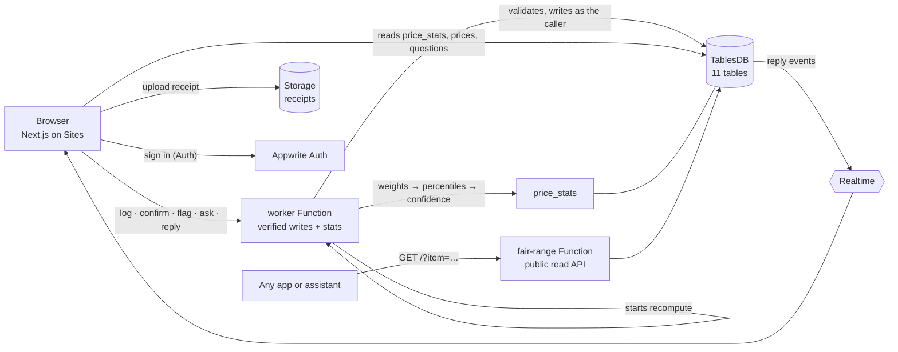

# Second Opinion

**Know the fair price before you pay.** Second Opinion is a verified, locality-level price layer for everything that isn't on an app: auto rides, plumbers, haircuts, street food. Locals share what they actually paid, newcomers check the fair range before they negotiate, and the community confirms or flags each other's numbers.

Built solo for the **Appwrite Databases Hackathon**, on **Appwrite TablesDB**. Development started on October 24, 2026 (after the October 19 start of the hackathon). Released under the [MIT License](LICENSE).

|  |  |
| --- | --- |
| **Live app** | https://6adcc60d0036a5cd4f5c.appwrite.network |
| **Public API** | https://6adcba4a001b8bfea9d0.appwrite.network/?item=auto-station-to-centre&locality=bpl-rani-kamlapati-station (reference and live try-it at `/api` in the app) |
| **Version log** | [docs/gap-analysis.md](docs/gap-analysis.md): every release measured against the plan's acceptance criteria |
| **UX plan** | [docs/ux-plan.md](docs/ux-plan.md): landing page, first run and user journey · [docs/final-polish-plan.md](docs/final-polish-plan.md): the pre-submission pass on the first visit |

```bash
curl "https://6adcba4a001b8bfea9d0.appwrite.network/?item=auto-station-to-centre&locality=bpl-rani-kamlapati-station"
# → ₹100, most people paid ₹95–106, high confidence, 26 prices from 17 people,
#   "first quotes here average 2.8x the fair price"
```

## Contents

- [Why an LLM can't answer this](#why-an-llm-cant-answer-this)
- [What you can do](#what-you-can-do)
- [How it works](#how-it-works)
- [Appwrite usage](#appwrite-usage)
- [Getting started](#getting-started)
- [Quality](#quality)
- [Repository layout](#repository-layout)
- [Demo data](#demo-data)
- [Roadmap](#roadmap)
- [Open-source libraries and data](#open-source-libraries-and-data)
- [License](#license)

## Why an LLM can't answer this

An assistant with an Uber or Maps MCP can quote a cab fare, because a company already built that database. The auto outside the station, the plumber your neighbour recommends, the barber, the chaiwala: no platform, no database, nothing to retrieve. Second Opinion is the thing that writes it down, with three properties a model can't supply on its own:

| | A model gives | Second Opinion gives |
| --- | --- | --- |
| Granularity | A city-level ballpark, often years old | A locality-level range from the last 90 days |
| Provenance | One number, no sample behind it | Median, typical range, N prices from M people, a confidence badge |
| Verification | No way for a local to correct it | Confirmations, flags and reputation weighting; the range self-corrects |

And because the fair range is an API, the next assistant can ask Second Opinion directly (an MCP server is on the roadmap).

## What you can do

| | |
| --- | --- |
| **Check** (no account) | Search an item (English or Hindi names), see the fair price for your area, how far to trust it, what to offer, settle at and walk away above, and whether a quote you got is fair |
| **Compare** | The same item in two cities, side by side with the ratio, or every item at once |
| **Share a price** | Pick the item and area (GPS-aware), type the amount, optionally attach a receipt photo. Saved drafts, sanity checks that name the unit, an offline queue |
| **Verify** | One tap to confirm a price you've paid too; flag one that looks wrong, with a reason. Three flags from different people hide a price |
| **Ask locals** | "Is ₹300 fair?" goes out with the current fair price attached; answers arrive live; the asker marks the helpful one |
| **Dark mode** | Follows your device by default; one tap in the header switches and remembers your choice, with no flash on load. The dark palette is chosen for contrast (every pair 4.5:1 or better), not just inverted |
| **Earn standing** | Newcomer → Regular → Trusted local, with a visible journey on your profile |

The bare address always shows the landing page; nothing redirects a returning visitor.

### The first visit

Designed so a stranger on a phone gets an answer before an explanation:

1. **Landing fold** (no scrolling): one sentence, a live price card labelled "demo", three city chips, the search box. Two things to tap: the card, or search.
2. **First card**: the price comes first; a three-line "how to read this card" strip sits under the badge and goes away on "Got it" or once scrolled past. When the number is for the whole city, the card offers "Pick your area for a local price".
3. **Use it**: start near, settle around, walk away above, plus "got a quote? check it".
4. **Contribute** only when there is something to say: the sign-in sheet says why, and the draft survives sign-in.
5. **Me**: a checklist from first price to trusted local, never a bare score.

## How it works



- **Clients read; one Function writes.** Table permissions let anyone read and nobody write. Every write goes through the `worker` Function, which learns the caller from Appwrite (never from the request body), validates the input again, limits each person to 20 prices a day, verifies receipts belong to the caller, and then writes with its own key. Nobody can post as a trusted local, forge a timestamp or inflate a counter.
- **No single price is trusted.** Each price is weighted by its author's standing × recency (`e^(-days/45)`) × 0.5 for new accounts × 2 with a receipt, plus 0.5 per same-city confirmation. The card shows the weighted median and the p25–p75 band. Only `paid` and `listed` prices feed the fair price; `quoted` prices feed the overcharge index.
- **Every number says how local and how sure it is.** The card prefers the locality and falls back to city, then state, when local data is thin. A fallback is labelled and capped at Medium confidence.
- **Overcharge index:** median first quote ÷ median paid price in a locality. At Rani Kamlapati (Habibganj) station it is about 2.8x; in residential Arera Colony about 1.2x.
- **Hiding is reversible and explained.** The third flag hides a price immediately, and the author sees why, so honest mistakes (wrong unit) can be shared again correctly.
- **Standing is recomputed from scratch** on every run (+0.1 per confirmation, −0.3 per flag), so it can't drift or be tampered with.
- **No vendor names, ever.** Prices belong to an item and an area, never a shop or a person.

## Appwrite usage

| Service | Used for |
| --- | --- |
| **TablesDB** | 11 tables, 88 columns and 17 indexes, including unique composite indexes that enforce one confirmation and one flag per person per price. Read-only permissions for clients; bulk `createRows` / `upsertRows` / `deleteRows`; deterministic row ids make every write idempotent |
| **Auth** | Email and password. Sessions identify the caller to the worker; every other sign-in method is switched off |
| **Functions** | `worker` is the only writer of anything: verified user writes, plus the hourly recompute of `price_stats`, counters and standing (it also starts a recompute right after a write, so a new price reaches the range in seconds). `fair-range` is the public, read-only API |
| **Realtime** | Answers stream to every open question page, filtered server-side with a query (measured at 210–340 ms) |
| **Storage** | Private `receipts` bucket (2 MB, images, encrypted). A receipt is readable only by the person who uploaded it |
| **Sites** | Next.js app with server rendering, so the card arrives as HTML on slow connections |

## Getting started

### Prerequisites

- Node.js 22 or newer
- An [Appwrite Cloud](https://cloud.appwrite.io) account (the free plan is enough) and the [Appwrite CLI](https://appwrite.io/docs/tooling/command-line/installation)

### Set up your own copy

```bash
npm install -g appwrite-cli && appwrite login
npm install
npm test                    # unit tests, no network needed
npm run seed:dry            # generate the dataset locally and print the seed checklist
npm run seed                # write it to Appwrite (mints a 1-hour API key), then recompute
npm run deploy:functions    # sync core/ and push both Functions
npm run deploy:web          # sync core/, deploy the site, then delete old builds
```

`appwrite.config.json` describes the whole project (database, tables, indexes, permissions, bucket, Functions, Site), so `appwrite push` recreates it in a fresh project. Update the project id in that file to your own first.

### Run the site locally

```bash
cd web && npm install && npm run dev
```

### Commands

| Command | What it does |
| --- | --- |
| `npm test` | Unit tests for the shared logic in `core/` |
| `npm run sync:core` | Copy `core/` into each deploy target (the deploy scripts do this for you) |
| `npm run seed` / `seed:dry` | Write or preview the demo dataset |
| `npm run stats` | Recompute the fair ranges now (add `-- --audit` to count non-demo rows) |
| `npm run deploy:functions` / `deploy:web` | Push the Functions or the Site, then prune old builds |
| `npm run prune` | Delete all but the active build of the site and Functions |
| `npm run warm` | Hit every route once so containers are awake before a demo |
| `npm run test:e2e` | The write-path suite against your project |
| `npm run test:ui -- <url>` | The 22-step browser journey against a deployed site |
| `npm run a11y -- <url>` / `perf -- <url>` | Accessibility and page-speed checks against a deployed site |
| `npm run shots -- <url> <dir> [light\|dark]` | Phone-size screenshots of every main screen, with a screen count per page |

> **Free-plan note.** Every site deploy stores a full Next.js build (about 230 MB) and the plan includes 2 GB of storage, so nine deploys fill it and Appwrite blocks the whole project (HTTP 402) until usage drops. `deploy:web` and `deploy:functions` delete old builds automatically; run `npm run warm` after a deploy, because the first requests to each route are slow while containers start.

## Quality

Everything below runs against the real backend, as real signed-in users, and cleans up after itself.

| Check | Command | Covers |
| --- | --- | --- |
| Unit tests | `npm test` | Weighted percentiles, decay, standing, three-flag hide, confidence, overcharge, scope fallback, geo, input rules (15 tests) |
| Write-path suite | `npm run test:e2e` | 40 checks as 5 real accounts: identity can't be forged, bad input is rejected with advice, receipts can't be stolen or reused, one confirmation and one flag each, third flag hides, daily limit, idempotent retries, the range updates within seconds |
| UI journey | `npm run test:ui -- <url>` | 22 steps on a phone viewport: sign up through the log form, receipt upload, confirm, flag, ask, answer live, edit profile, sign out and in, offline queue, the API page, not-found pages, both themes |
| Accessibility | `npm run a11y -- <url>` | axe-core (WCAG 2.1 A/AA plus best practices) on every screen and the open sheets, in light and dark: 0 violations |
| Page speed | `npm run perf -- <url>` | Fast 3G and Slow 3G with a 4x slower CPU, cold cache |
| Visual check | `npm run shots -- <url> <dir>` | Phone-size screenshots of every main screen, with the page length in screens (the landing is kept under seven) |

The browser tests need a Chromium-based browser (Edge or Chrome) installed locally.

## Repository layout

| Path | What |
| --- | --- |
| `appwrite.config.json` | The whole Appwrite project as code |
| `core/` | Pure, unit-tested logic shared by everything: stats engine, card model, geo, input rules. Copied into each deploy target by `npm run sync:core`; edit `core/`, never the copies |
| `functions/worker`, `functions/fair-range` | The two Functions (the free plan allows two) |
| `seed/` | Deterministic demo-data generator, reference data and seed runner |
| `web/` | Next.js app (App Router, Tailwind): marketing and app shells, server-rendered card pages |
| `scripts/` | Key minting (`with-key`), recompute, the browser launcher (`edge`), tests (`e2e-backend`, `e2e-ui`, `a11y`, `perf`, `perf-trace`, `shots`), `warm`, `prune-deployments`, `sync-core`, cleanup |
| `docs/` | `gap-analysis.md` (version log and incidents), `ux-plan.md` (front door, first run and user journey), `final-polish-plan.md` (the pre-submission UX pass) |
| `Second Opinion Hackathon Scope & Build Plan.md` | The original scope and acceptance criteria every version is measured against |
| `LICENSE` | MIT |

## Demo data

**All current data is seeded for the hackathon demo, and the app says so on every screen** (the "Demo data" pill in the header and the footer note, which links to the explanation in the FAQ). It is generated by `seed/generate.ts`, deterministically from a fixed random seed:

- 3 cities, 120 real localities (coordinates cross-checked against OpenStreetMap), 21 items in 4 categories, 40 demo accounts.
- About 2,000 prices. Base prices are hand-set per city, with log-normal noise (σ ≈ 0.15), rounded the way people round, and dated mostly within the last 75 days.
- First quotes are 2–3x the fair price at stations and tourist spots, and 1.1–1.4x in residential areas.
- 10 deliberate outliers (a ₹900 auto per km, a ₹5 plumber visit) carry two flags each, so one more flag in the demo hides them.
- 15 sample questions with answers. Receipt images on demo prices are placeholders marked with a diagonal band.

The prices are illustrative, not survey results, and should not be relied on for real purchases. Re-seeding only replaces rows marked `is_seed`; real people's prices are never touched.

## Roadmap

An MCP server so assistants can ask for fair prices directly · more cities, opened by questions · VectorsDB alias matching ("tuk tuk" → autorickshaw) · a Hindi interface · a moderation queue · groceries and rent.

## Open-source libraries and data

[Next.js](https://nextjs.org) · [React](https://react.dev) · [Tailwind CSS](https://tailwindcss.com) · [lucide-react](https://lucide.dev) · [Appwrite web SDK](https://github.com/appwrite/sdk-for-web) and [node-appwrite](https://github.com/appwrite/sdk-for-node) · [server-only](https://www.npmjs.com/package/server-only) · [TypeScript](https://www.typescriptlang.org) · [tsx](https://tsx.is) · [puppeteer-core](https://pptr.dev) and [axe-core](https://github.com/dequelabs/axe-core) (tests only).

Locality coordinates were checked against [OpenStreetMap](https://www.openstreetmap.org/copyright) (© OpenStreetMap contributors, ODbL); the repository ships its own coordinate values, not an OpenStreetMap extract. Each dependency keeps its own license; none are copied into this repository.

## License

Second Opinion is released under the [MIT License](LICENSE). Copyright © 2026 SpandanM110. You may use, copy, modify and distribute it, including commercially, as long as the copyright and license notice stay with it. It comes with no warranty.
